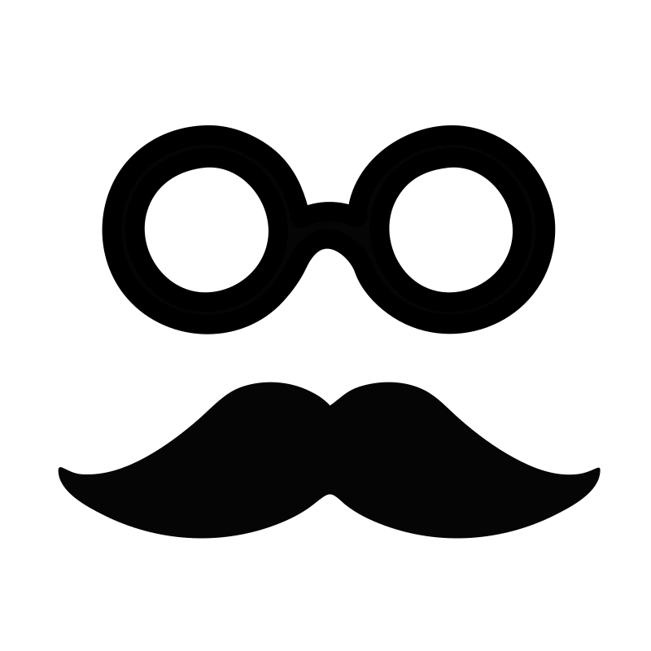

# App button iconography: before and after

All app button icons covered by this pass are now external 24×24 SVG assets with a 2px rounded outline and `currentColor`. App CSS uses a shared mask class so icons inherit each screen's text and brand colors. The overlay loads the same shared icon stylesheet and assets from `/app/media/icons/`.

The table lists every changed icon occurrence. Stateful buttons include the template location and the JavaScript location that swaps the icon. Line numbers refer to the source files, not generated HTML.

| View / screen | File + line | Button purpose / label | Before | After |
| --- | --- | --- | --- | --- |
| App global controls | `app/templates/global/controls.html:2` | Back to landing page | 🏠︎ | `app/media/icons/home.svg`  |
| App global controls | `app/templates/global/controls.html:7` | Appearance settings | 🎨 | `app/media/icons/palette.svg`  |
| App global controls | `app/templates/global/controls.html:10` | Admin Portal shortcut in the app | 🔒 | `app/media/icons/lock.svg`  |
| Settings modal | `app/templates/global/settings-modal.html:5` | Close settings | ✕ | `app/media/icons/close.svg`  |
| Settings modal | `app/templates/global/settings-modal.html:11`; `app/js/shell/scoreboardControls.js:254`; `app/js/court/session.js:179` | Mute / unmute audio | ♫ / ♫⃠ | `music.svg` / `music-muted.svg`   |
| Settings modal | `app/templates/global/settings-modal.html:17`; `app/js/ui/appearance.js:269`; `app/js/court/session.js:185` | Toggle scoreboard waves | ♒︎ / ═ | `waves.svg` / `waves-off.svg`   |
| Settings modal | `app/templates/global/settings-modal.html:23` | Show QR panel | ▦ | `app/media/icons/qr.svg`  |
| Settings modal | `app/templates/global/settings-modal.html:29`; `app/js/ui/fullscreen.js:34` | Enter / exit fullscreen | ⛶ / ⬚ | `fullscreen.svg` / `fullscreen-exit.svg`   |
| Settings modal | `app/templates/global/settings-modal.html:34`; `app/js/shell/scoreboardControls.js:126`; `app/js/scoring/changeover.js:49` | Swap views | ⇆ / ⇄ | `swap.svg` / `swap-alt.svg`   |
| Settings modal | `app/templates/global/settings-modal.html:43`; `app/js/ui/settingsTiles.js:97` | Changeover | ↔ | `app/media/icons/changeover.svg`  |
| Settings modal | `app/templates/global/settings-modal.html:48`; `app/js/shell/scoreboardControls.js:235` | Toggle server indicator | ⚾︎ / ⭘ | `server.svg` / `server-off.svg`   |
| Settings modal | `app/templates/global/settings-modal.html:53` | Edit player names | 👥 | `app/media/icons/users.svg`  |
| Settings modal | `app/templates/global/settings-modal.html:58` | Reset match | `!` | `app/media/icons/reset.svg`  |
| Settings modal | `app/templates/global/settings-modal.html:63` | New match | ＋ | `app/media/icons/plus.svg`  |
| Settings modal | `app/templates/global/settings-modal.html:72` | Open OBS score overlay | 📺 | `app/media/icons/monitor.svg`  |
| Settings modal | `app/templates/global/settings-modal.html:78` | Join as a player | Inline SVG:  | `app/media/icons/player.svg`  |
| Settings modal | `app/templates/global/settings-modal.html:84` | Switch to spectate mode | ⛱ | `app/media/icons/eye.svg`  |
| Join court modal | `app/templates/global/settings-modal.html:195` | Close join court | ✕ | `app/media/icons/close.svg`  |
| Player names modal | `app/templates/global/player-names-modal.html:5` | Close player names | ✕ | `app/media/icons/close.svg`  |
| Play view | `app/templates/pages/play.html:7` | Close play view | ✕ | `app/media/icons/close.svg`  |
| Spectate view | `app/templates/pages/spectate.html:7` | Close spectate view | ✕ | `app/media/icons/close.svg`  |
| Match details | `app/templates/global/details-modal.html:5` | Close match details | ✕ | `app/media/icons/close.svg`  |
| Match details | `app/templates/global/details-modal.html:7` | Share match details | Inline SVG:  | `app/media/icons/share.svg`  |
| Match details | `app/templates/global/details-modal.html:55` | Expand detailed stats (icon beside text) | ▼ | `app/media/icons/chevron-down.svg`  |
| Share-image preview (currently commented out) | `app/templates/global/modals.html:42` | Close share image preview | ✕ | `app/media/icons/close.svg`  |
| Scoreboard | `app/templates/pages/scoreboard.html:129` | Back / exit scoreboard | ✕ | `app/media/icons/close.svg`  |
| Scoreboard | `app/templates/pages/scoreboard.html:135` | Undo last point | ↩ | `app/media/icons/undo.svg`  |
| Scoreboard | `app/templates/pages/scoreboard.html:138` | Open options | ⛭ | `app/media/icons/settings.svg`  |
| Scoreboard | `app/templates/pages/scoreboard.html:145` | Open match details | Inline SVG:  | `app/media/icons/chart.svg`  |
| Scoreboard | `app/templates/pages/scoreboard.html:152` | Share court | Inline SVG:  | `app/media/icons/share.svg`  |
| Broadcast overlay | `app/overlay/template.html:131` | Toggle stat card | 📊 | `app/media/icons/chart.svg`  |
| Broadcast overlay | `app/overlay/template.html:134` | Toggle momentum graph | 📈 | `app/media/icons/trend.svg`  |
| Broadcast overlay | `app/overlay/template.html:137` | Show sponsor slate | 🎬 | `app/media/icons/clapperboard.svg`  |
| Broadcast overlay | `app/overlay/template.html:140` | Customize overlay | ⚙ | `app/media/icons/settings.svg`  |
| Broadcast overlay | `app/overlay/template.html:147` | Close overlay settings | `&times;` (`×`) | `app/media/icons/close.svg`  |
| Broadcast overlay | `app/overlay/template.html:207` | Add sponsor (text label retained) | `+ Add sponsor` | `app/media/icons/plus.svg`  + “Add sponsor” |
| Broadcast overlay sponsor editor | `app/overlay/js/settingsPanel.js:102` | Remove sponsor | `×` | `app/media/icons/close.svg`  |
| Broadcast overlay settings | `app/overlay/js/settingsPanel.js:278` | Successful copy feedback | `Copied ✓` | `app/media/icons/check.svg`  + “Copied” |

## Side-by-side previews

Open [`iconography-report/index.html`](iconography-report/index.html) for a local, side-by-side comparison of every changed icon in light and dark preview tiles. Original inline SVGs are preserved under [`iconography-report/before/`](iconography-report/before/); the revised SVGs remain in `app/media/icons/`.

## Intentionally unchanged

- Admin portal pages and admin-only modules, plus `device-harness/`, `nfc/`, and the root marketing website, are out of scope.
- Decorative background waves remain inline SVG because they are not button icons.
- The `⋮` color-edit marks sit beside color-picker buttons rather than inside a button; warning/status symbols and the scoreboard swap animation are also non-button content.
- Text-only match and tournament actions remain text labels; they had no icon to replace.
